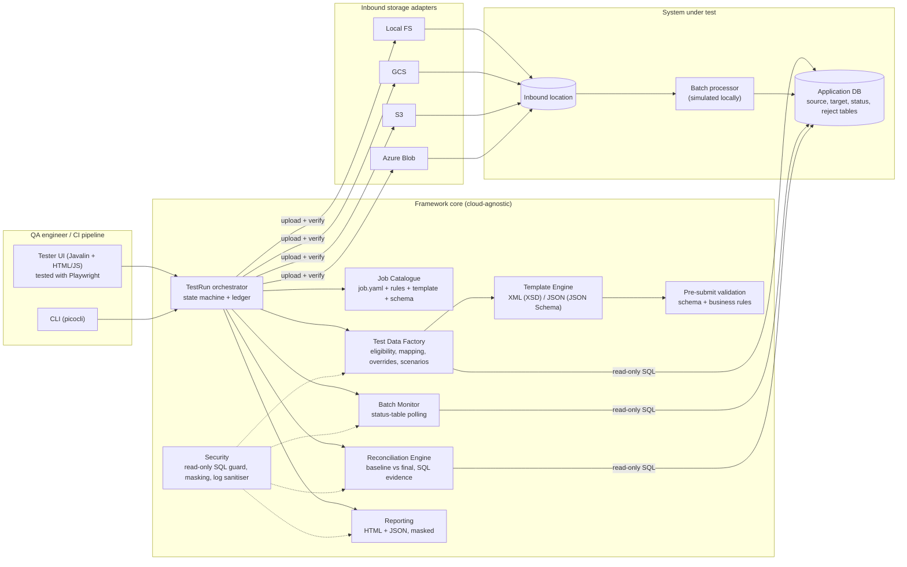
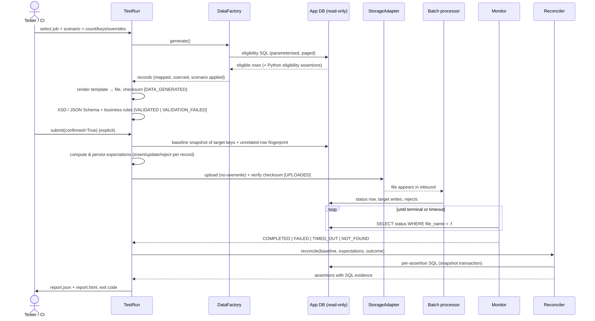

# Batch Job Automation Test Framework — Architecture (Java + Playwright)

Architecture, data flow, interface contracts, assumptions and technology choices for the
Java implementation. The design is the same as the earlier Python version; the tester UI
(Phase 5) is now included and covered by Playwright tests.

## 1. Architecture

Separation rules:

- Core logic never imports a cloud SDK. SDK calls live only in `src/cloud/java` (built with `-Pcloud`), loaded by class name.
- Database access is independent of storage provider. The framework holds a **read-only** connection; only the system under test (or the simulator) writes.
- All job-specific behaviour lives in `jobs/<job-id>/`. The core contains no `if job == ...` branches.

## 2. Lifecycle (sequence)

Run states: `CREATED → DATA_GENERATED → VALIDATED → UPLOADED → PROCESSING → COMPLETED | FAILED | TIMED_OUT | NOT_FOUND`, plus `VALIDATION_FAILED` and `ERROR`. Application-specific status values (QUEUED, RUNNING, REJECTED…) are configured per job and mapped onto these.

## 3. Interface contracts

| Contract | Class | Responsibility |
|---|---|---|
| `JobConfig`, `ValidationRules` (records, strict Jackson) | `config/` | Schema for registering a job; unknown YAML keys rejected |
| `JobCatalogue.get / rows` | `catalogue/JobCatalogue` | Load, cross-validate, list jobs with configuration status |
| `ReadOnlyDatabase.query / snapshot` | `db/` | SELECT/WITH only, bound `:named` params, query timeout, read-only connection |
| `TestDataFactory.fetchEligible / select / build / synthesize / applyOverrides` | `data/` | Eligibility, shortage reporting, mapping, generators, coercion |
| `Scenarios.apply` | `data/Scenarios` | Data-driven mutations: set / drop / duplicate / empty / malformed |
| `FormatHandler.render / validate` | `template/` | FreeMarker → bytes; XSD or JSON Schema validation, record count |
| `InboundStorageAdapter` | `storage/` (+ `src/cloud/java`) | Provider-neutral delivery; create-only writes, SHA-256 verification, bounded retries |
| `BatchMonitor.waitFor` | `monitor/` | Poll the status table; distinguish FAILED / TIMED_OUT / NOT_FOUND / AMBIGUOUS |
| `Expectations.build` | `reconcile/` | Predict each record's outcome before submission |
| `Reconciler.captureBaseline / reconcile` | `reconcile/` | Assertions A–F with SQL evidence |
| `TestRun` | `runner/` | State machine, explicit submission, idempotency ledger, verdict + exit code |
| `UiServer` | `ui/` | REST API behind the four tester screens |

Exit codes: `0` pass · `1` test failure (assertion) · `2` configuration error / blocked submission · `3` infrastructure error · `4` timeout or execution not found · `5` insufficient eligible data.

## 4. Assumptions (to confirm against the real batch application)

1. **Correlation key.** The batch application records the inbound **file name** in its status table. If it uses its own execution ID only, the monitor needs a second lookup (e.g. an audit table mapping file → execution). Configurable via `monitoring.file_name_column`.
2. **Status table is authoritative.** Completion is only accepted from the database, never from an event alone.
3. **Inbound path = storage prefix.** For local, GCS, S3 and Azure we assume the batch picks up files from the configured prefix. Where an MFT/SFTP hop or event trigger sits in between, a dedicated adapter is required (Phase 6).
4. **Reject table exists** with execution ID, record key and reason. If rejects are only in logs, Validation D for rejects degrades to counts only.
5. **Lineage column.** Target rows carry the source file name (`last_batch_file` / `batch_file`). This is what makes "unexpected records" detectable; without it the framework falls back to key-scoped checks.
6. **Pagination SQL** uses `LIMIT/OFFSET` (SQLite, PostgreSQL, MySQL). Oracle / SQL Server need a dialect-specific wrapper — a small change in `TestDataFactory.fetchEligible`.
7. **Test environments only.** Submission is refused when `is_production: true`. Eligibility queries run read-only everywhere.
8. **Unrelated-row guard** hashes all target rows outside the test keys. Correct on an isolated QA database; on a shared, busy database switch it off (`guard_unrelated_rows: false`) and rely on lineage checks.

## 5. Technology choices and trade-offs

| Choice | Why | Trade-off |
|---|---|---|
| Java 21 + Maven | Matches the team's stack; records and switch expressions keep config code small | — |
| Jackson (YAML) with records | Strict binding, one library for YAML and JSON | Validation logic lives in `validate()` methods rather than annotations |
| FreeMarker | Readable templates; XML output format escapes everything automatically | JSON values must be pre-encoded (done by the handler) |
| JDK XSD validator + networknt JSON Schema | Real XSD 1.0 and JSON Schema 2020-12, no network access, DOCTYPE refused | — |
| Commons JEXL (sandboxed) | Expressions in YAML without a home-grown parser | JEXL syntax (`=~` for membership) differs slightly from SQL |
| Plain JDBC | Raw parameterised SQL stays visible as evidence; any driver works | Dialect gaps (paging) handled in one place |
| Javalin + vanilla JS | Small, no front-end build chain, easy to put behind SSO | Not a design-system UI; swap for the in-house framework later without touching the core |
| Playwright for Java | Tests the UI as a tester uses it; per-test traces for debugging | Needs Chromium (downloaded once) |
| Cloud SDKs behind `-Pcloud` | Default build stays small; adapters loaded by class name | Cloud builds need the profile |

## 6. Status

| Phase | Scope | Status |
|---|---|---|
| 1 | Architecture, contracts, assumptions | Done |
| 2–4 | Vertical slice, template engine, eligibility, generation, submission, monitoring, reconciliation | Ported from the tested Python version; **Java build not yet run** |
| 5 | Tester UI (4 screens + report history) with Playwright tests | Written; **not yet run** |
| 6 | GCS / S3 / Azure adapters | Written; unverified against real accounts |
| 7 | CI/CD | Pipeline example included; not run in a real CI |
